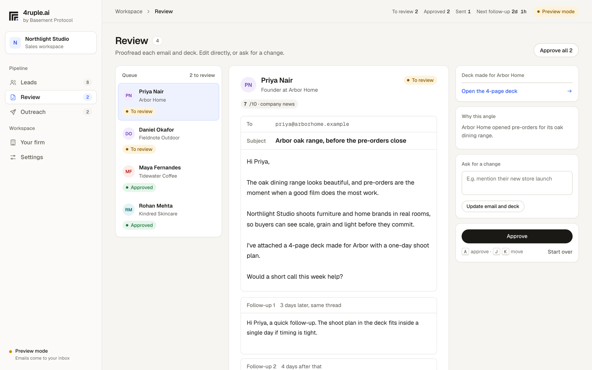
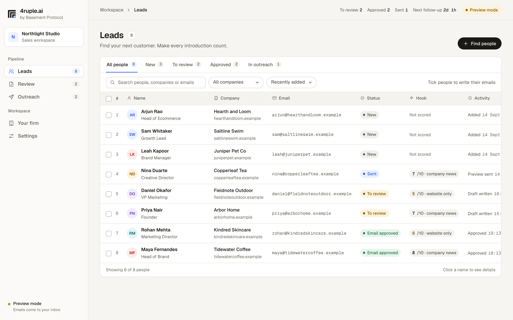

# 4ruple.ai

By Basement Protocol. Find people at the companies you want to work with, get a personal email, two follow-ups and a 4-page deck made for each one, approve them, and send from your own Gmail. Ask for more slides on Review and the deck grows.



4ruple runs on your laptop. Your leads, keys and emails stay there, and every email and deck is written by your own Claude Code sign-in, so there's no per-email AI fee.



## What you need

- A Mac. Windows and Linux are untested for now.
- [Node.js 22](https://nodejs.org)
- [Google Chrome](https://www.google.com/chrome), to turn decks into PDFs
- [Claude Code](https://www.npmjs.com/package/@anthropic-ai/claude-code), signed in with a paid Claude plan. 4ruple's writing counts toward your plan's usage limits.
- A Gmail account with 2-step verification and an [app password](https://myaccount.google.com/apppasswords)
- A 4ruple licence key, from [basementprotocol.com/4ruple](https://basementprotocol.com/4ruple). There is no free trial: the key is what opens the app.
- Optional: an Apollo, Prospeo or Hunter key to find people. You can also upload a CSV.

## Install and start

```sh
npm install -g @anthropic-ai/claude-code   # skip if you already have Claude Code
claude auth login                          # skip if you're already signed in
npx 4ruple
```

`npx 4ruple` checks your laptop, starts 4ruple and opens it in your browser. Paste your license key, then follow the steps on screen: Your firm, Leads, Review, Outreach. Keep the Terminal window open while you use it; close it or press Ctrl+C to stop.

Run `npx 4ruple` again whenever you want to use it. To update, run `npx 4ruple@latest`.

## Your license

- One key runs on one laptop at a time, and activating asks for the email address you bought with, so keep the purchase email.
- To move it to a new laptop, run `npx 4ruple deactivate` on the old one. If the old one is gone, the key screen on the new laptop lets you remove it.
- 4ruple checks the key online about once a week and keeps working offline in between.
- The licence service only sees your key, your purchase email, a one-way hash of your device id and of the internet connection you activated from, the device name and the app version. Nothing about your leads or emails.
- Teams are one licence per person: a two-person pack is one purchase and two keys.

## Working as a team

Each person buys their own licence, installs 4ruple on their own Mac and keeps using their own Claude Code. One licence is one seat.

- The owner creates the team in Settings and invites people with a code that works once and lasts 7 days.
- Everyone's leads, drafts and activity sync to the team, so **the owner can see what each teammate did that day**, and so two people never email the same person.
- A member sees their own work plus team totals. The owner sees everyone's leads, drafts and feed.
- The do-not-contact list is shared: if one person marks someone off limits, nobody on the team can email them.
- Gmail details, lead-search keys and deck files never leave your laptop, on a team or not.

If you are on a team, your drafts are visible to the team owner. The app says so in Settings.

## Your data

Everything lives in `~/.4ruple` on your laptop: your firm profile, leads, drafts, decks, Gmail app password and lead-search keys. Delete that folder to remove it all.

## Commands

```
npx 4ruple              check this laptop, start 4ruple and open it
npx 4ruple doctor       only run the checks
npx 4ruple deactivate   take this laptop off your license
  --port 4700           use another port
  --no-open             don't open the browser
```

## If something goes wrong

- **Claude Code is not signed in:** run `claude auth login`, then `npx 4ruple` again.
- **Chrome not found:** install Chrome, or set `CHROME_BIN` to where it is.
- **Gmail says the password is wrong:** you need a Google app password (16 letters), not your normal password.
- **Emails don't write:** open Terminal, run `claude`, and check it answers. If your plan's usage limit is reached, writing resumes when it resets.

---

## For developers

This repo is the app and its license service.

- `./run.sh` runs the app from the repo at http://localhost:4600 with `./data`, and never asks for a license.
- `npm test` runs the license tests against a local copy of the license service.
- `bin/4ruple.js` is the `npx` launcher. `lib/license.js` is the app's license check. `lib/license-core.js` holds the rules shared with the Supabase functions (the copy in `supabase/functions/_shared/` must stay identical; the tests check).
- `supabase/` has the database migration and the `license` and `issue-license` edge functions.
- `docs/LAUNCH.md` covers setting up Supabase, email, Razorpay and npm, step by step.
